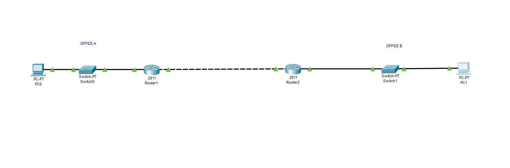

# Проект 01: Связность двух офисов

## Цель
Настроить связь между двумя удаленными офисами (Офис А и Офис Б) через выделенный канал с использованием статической маршрутизации.

## Использованные технологии
*   IP-адресация и подсети (Subnetting)
*   Статическая маршрутизация (Static Routing)
*   Cisco Packet Tracer

## Топология и адресация

| Устройство | Интерфейс | IP-адрес | Шлюз по умолчанию |
| :--- | :--- | :--- | :--- |
| PC0 (OFFICE А) | Fa0 | 192.168.1.10/24 | 192.168.1.1 |
| Router1 | Gi0/0 | 192.168.1.1/24 | - |
| Router1 | Gi0/1 | 10.0.0.1/24 | - |
| Router2 | Gi0/0 | 10.0.0.2/24 | - |
| Router2 | Gi0/1 | 192.168.3.1/24 | - |
| PC1 (OFFICE B) | Fa0 | 192.168.3.10/24 | 192.168.3.1 |

## Конфигурация (ключевые команды)

**Router1 (OFFICE А):** `ip route 192.168.3.0 255.255.255.0 10.0.0.2`

**Router2 (OFFICE B):** `ip route 192.168.1.0 255.255.255.0 10.0.0.1`

##  Результат

Пинг между OFFICE А и OFFICE B успешно проходит. TTL = 126 (пакет проходит через два маршрутизатора).
